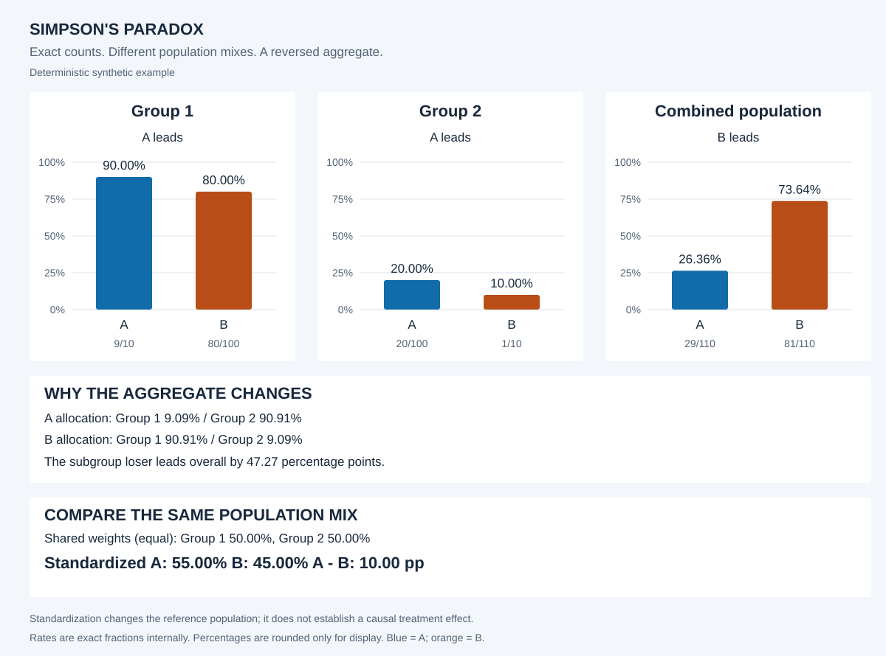

# Simpson's paradox and stratification

A small, dependency-free .NET 10 console project demonstrating how every subgroup can favor one treatment while the combined population favors the other. All decisions use exact integer counts and rational arithmetic.



## Run

Requires the .NET 10 SDK. From the repository root:

```powershell
dotnet build -c Release
dotnet run --project src/SimpsonParadox -c Release -- demo
dotnet run --project src/SimpsonParadox -c Release -- search
dotnet run --project tests/SimpsonParadox.Tests -c Release
```

The tests are a dependency-free executable, **not a `dotnet test` test-adapter project**. A failed check exits nonzero. For build, numerical tests, and CLI integration checks together, use PowerShell 7:

```powershell
pwsh -File scripts/verify.ps1
```

No external packages or GitHub Actions workflows are needed.

Each application run writes `report.json` and a standalone `report.svg` under `artifacts/demo` or `artifacts/search`. Open the SVG in a browser. Output files in the selected directory are replaced on subsequent runs, including when no reversal is found.

```powershell
dotnet run --project src/SimpsonParadox -c Release -- demo --weights pooled --output artifacts/pooled
dotnet run --project src/SimpsonParadox -c Release -- search --max-total 12 --max-configurations 1000000 --weights pooled
dotnet run --project src/SimpsonParadox -- --help
```

Options are strict: unknown/duplicate options and invalid values fail with exit code 2. Successful reports, including searches with no reversal, exit 0.

## The synthetic example

| Population | A successes / cases | A rate | B successes / cases | B rate |
|---|---:|---:|---:|---:|
| Group 1: easier cases | 9 / 10 | 90% | 80 / 100 | 80% |
| Group 2: harder cases | 20 / 100 | 20% | 1 / 10 | 10% |
| Combined | 29 / 110 | 26.36% | 81 / 110 | 73.64% |

A leads by 10 percentage points in each group. B leads overall by exactly `26/55`, or approximately **47.27 percentage points**. This is synthetic data, not clinical evidence.

The combined rates use different weights: A has 90.91% harder cases, while B has 90.91% easier cases. The JSON report records both group proportions for each treatment.

## Exact calculations

For treatment `t` and group `g`, let `s[t,g]` be successes, `n[t,g]` the positive total, `p[t,g] = s[t,g]/n[t,g]`, and `q[t,g] = n[t,g]/sum(n[t,*])`.

- Group rate: `p[t,g]`.
- Overall rate: `sum(s[t,*])/sum(n[t,*]) = sum(q[t,g] * p[t,g])`.
- Strict reversal: both group differences have the same nonzero sign, and the overall difference has the opposite sign. Ties are excluded.
- Reversal magnitude: the positive overall advantage of the treatment that loses in both groups; zero if there is no strict reversal.

`Rational` normalizes fractions using `BigInteger`. Comparisons cross-multiply exactly. Overall totals are promoted before addition to avoid integer overflow. The search uses bounded `Int64` cross products, with a documented bound that keeps every product safe. Floating point appears only when formatting percentages or positioning SVG bars.

## Direct standardization

Choose shared nonnegative weights that sum to one and calculate `P*[t] = sum(w[g] * p[t,g])` for both treatments.

- `equal`: each group has weight `1/2`.
- `pooled`: each group's weight is its combined A+B count divided by all cases.

Both choices happen to be 50/50 for the demo. The tests also exercise unequal pooled weights. With equal weights, A is **55%** and B is **45%**. A shared weighted average preserves a strict advantage present in every group.

To quantify the effect of composition, the JSON includes each group's signed contribution:

```text
effect[g] = (q[A,g] - w[g]) * p[A,g] - (q[B,g] - w[g]) * p[B,g]
sum(effect) = raw(A - B) - standardized(A - B)
```

For the demo, the total composition effect is `-63/110`, or -57.27 percentage points: the raw gap is -47.27 points, while the standardized gap is +10 points. This is an algebraic decomposition relative to the selected weights, not a causal attribution.

## Deterministic bounded search

Each cell has `1 <= total <= maxTotal` and `0 <= successes <= total`. There are `maxTotal*(maxTotal+3)/2` possible cells, and the fourth power of that number possible datasets. Zero and full success cells are intentionally included.

Enumeration order is A/group 1, A/group 2, B/group 1, B/group 2; each cell is ordered by total, then successes. The search accepts both reversal directions and retains the first dataset when maximum magnitudes tie. Treatment/group relabelings count as distinct configurations.

Defaults: `maxTotal=8`, `maxConfigurations=10000000`. The default search exhausts **3,748,096 configurations**, finds **19,020 reversals**, and selects:

| Population | A | B |
|---|---:|---:|
| Group 1 | 0 / 1 | 1 / 8 |
| Group 2 | 7 / 8 | 1 / 1 |
| Combined | 7 / 9 | 2 / 9 |

B wins each group, but A wins overall by `5/9` (55.56 points). Equal-weight rates are A `7/16` and B `9/16`.

`maxTotal` supports 1..1000; `maxConfigurations` is a positive signed 64-bit integer. Enumeration is streaming with constant retained dataset storage. Runtime grows with the number of configurations examined. The count limit is deterministic; it is not a wall-clock timeout.

A limited search reports **examined prefix** and never claims a global optimum. No result means no reversal was found in the examined space, not that reversals cannot exist. A no-result run still writes JSON metadata and an explanatory SVG.

## Reports and verification

JSON schema version 1 contains exact fraction strings, rounded percent strings, cell counts, proportions, raw and standardized gaps, composition effects, reversal magnitude, and search coverage. Fractions are rates: multiply by 100 for percent or percentage-point units. Search-space size is a decimal string to preserve arbitrarily large counts. Demo search metadata is null; unsuccessful search analysis is null.

The SVG uses a shared 0–100% scale for its three grouped bar charts, consistent A/B colors, exact count labels, allocation summaries, and a standardized comparison. Group labels remain neutral for searched datasets.

Verification covers arithmetic normalization, invalid inputs, large counts, ties, swaps, weight endpoints, unequal pooled weights, decomposition identities, search limits, determinism, JSON fractions, SVG structure, and locale-independent rendering. An independently enumerated rational reference checks all 38,416 datasets with cell totals up to four against the optimized search (28 reversals). The CLI script checks full default search results, truncated/empty runs, repeatable output, and error handling.

## Interpretation

The within-group and aggregate calculations can all be correct. They answer questions about differently weighted populations. Group membership can explain an aggregate association, but the observed table alone does not establish causal confounding or identify a treatment effect. Choosing adjustment variables and reference weights requires subject-matter and causal assumptions; indiscriminate stratification can also mislead.

## Source layout

- `Rational.cs`, `Dataset.cs`: exact arithmetic and validated counts.
- `Analysis.cs`: reversal detection, standardization, composition effects.
- `DatasetSearch.cs`: bounded enumeration and deterministic selection.
- `Report.cs`, `Program.cs`: SVG/JSON reports and CLI.
- `tests/SimpsonParadox.Tests`: executable reference and verification suite.
